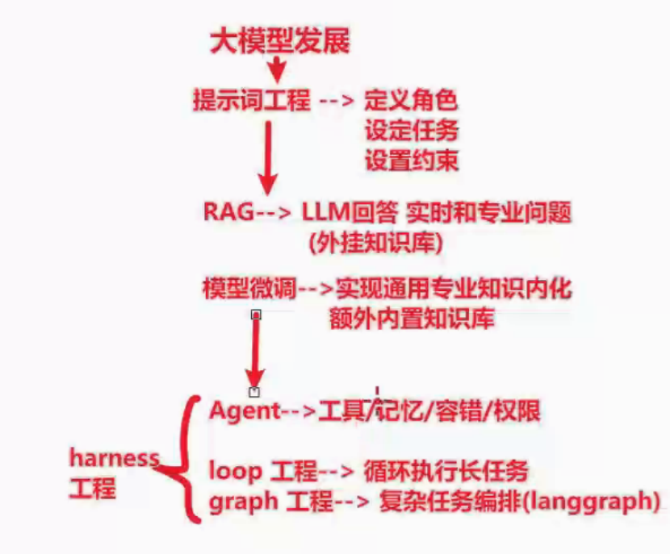
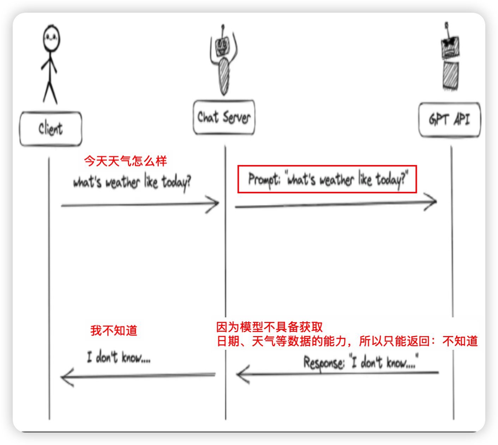
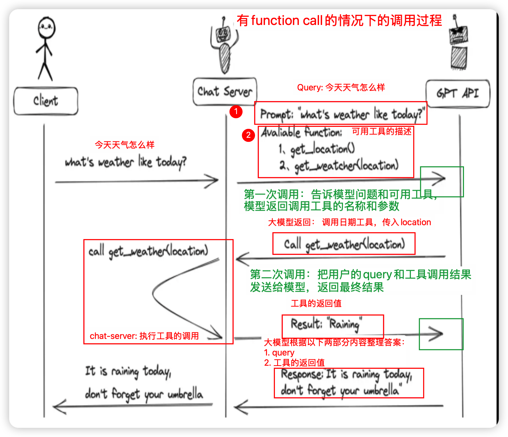
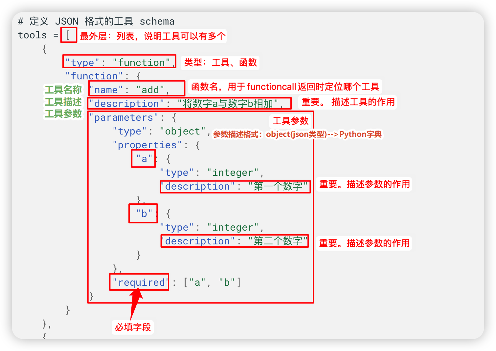
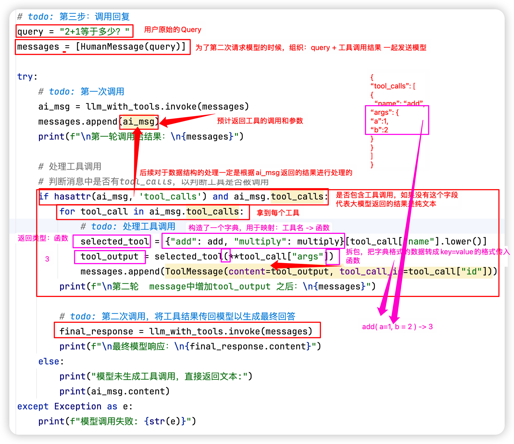
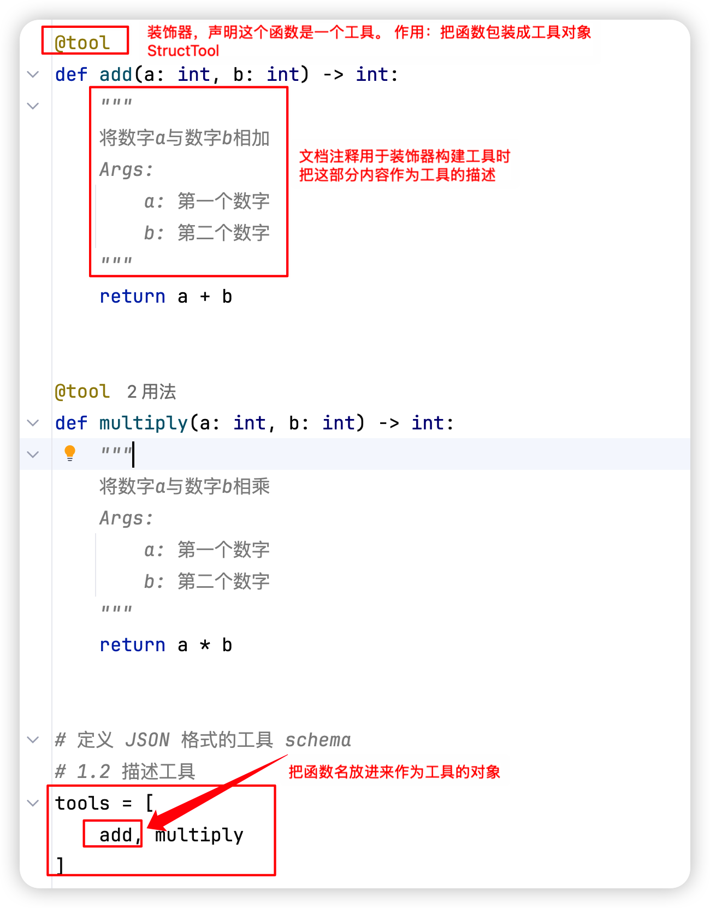
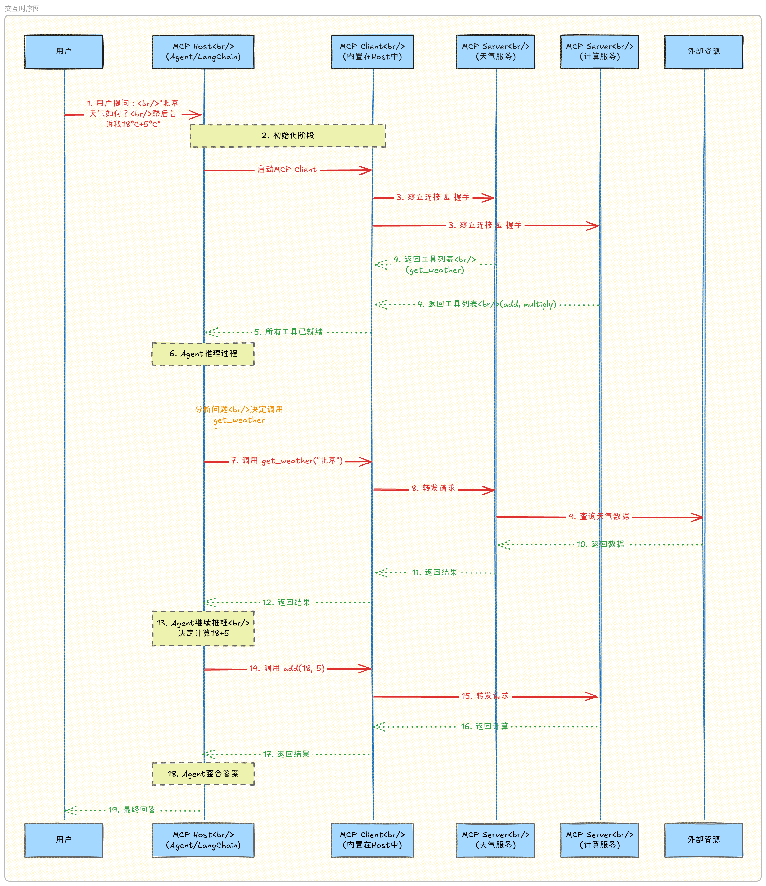
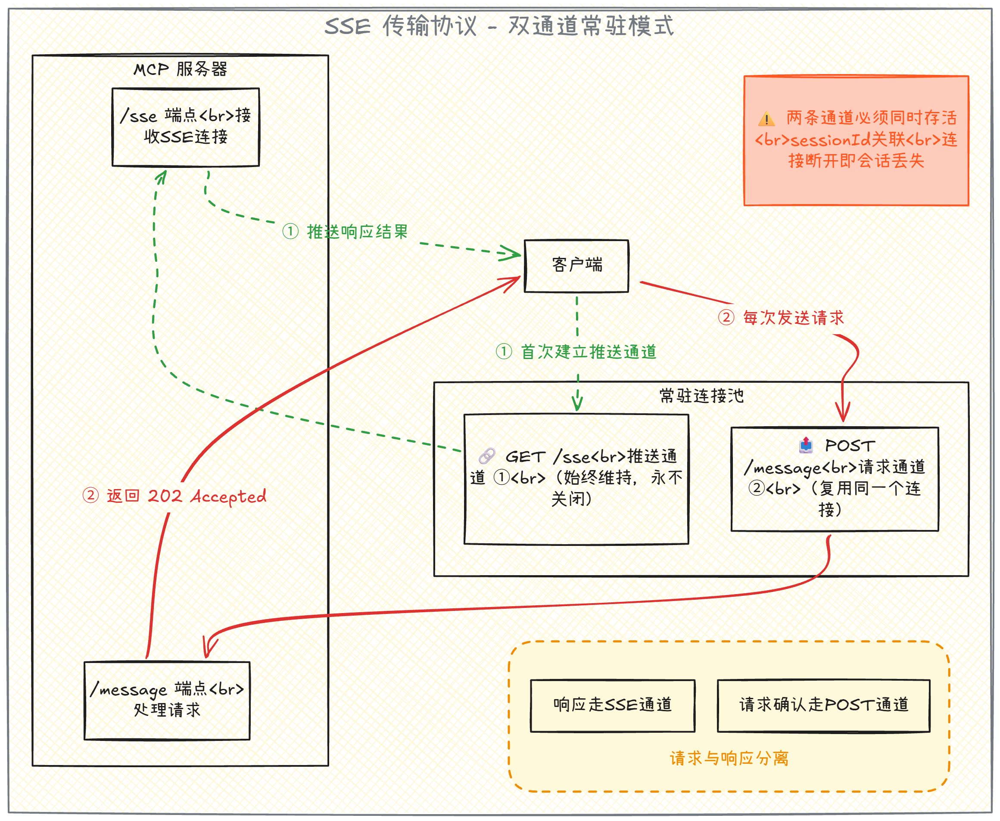
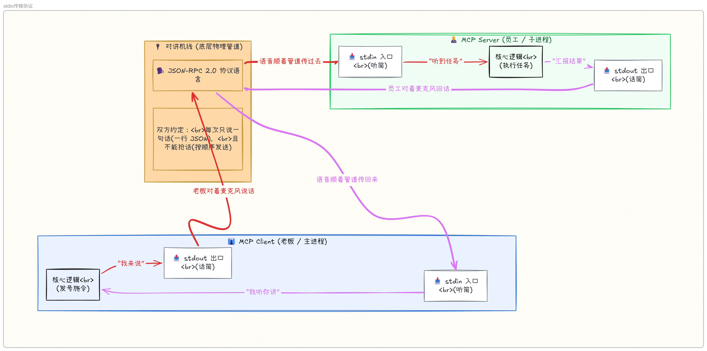
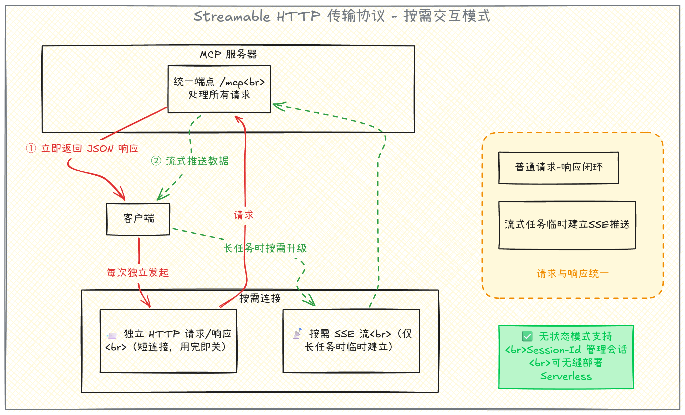

# Function Calling

::: info 阅读说明
本文由个人 Notion 学习笔记整理发布。正文、公式、配图和示例代码按原笔记保留，仅转换展示格式。示例代码未进行模型 API 端到端验证，部分片段可能需要修正和配置后才能运行；请勿把展示代码视作已验证程序。
:::

## 学习目标

- 熟悉Function Call 概念和工作原理
- 熟悉Function Call 的基本使用

## 拓展：缩放定律（Scaling Law）

### 1. 什么是缩放定律

<b>Scaling Law（缩放定律）是深度学习，特别是大语言模型领域最关键的经验性发现之一：模型性能（通常用损失 Loss 衡量）会随着模型规模、数据量和计算资源的增加而系统性提升，并且这种提升遵循可预测的数学规律。</b>

一句话概括：模型越大、数据越多、算力越足，表现通常越好，而且“好多少”可以用公式预估。

> 核心问题不是“模型越大越好”，而是“在有限的算力预算下，模型该做多大、该喂多少数据”。

### 2. 核心公式：幂律形式的损失分解

最通用的形式是一个加法模型，把模型的最终损失 $L$ 拆成三部分：

$$
L(N, D) = E + \frac{A}{N^{\alpha}} + \frac{B}{D^{\beta}}
$$

| 符号 | 名称 | 含义 |
| --- | --- | --- |
| $E$ | 不可约损失 | 理论下界，代表数据本身固有的熵（不确定性）；无论模型多大、数据多好，损失都无法低于它 |
| $A / N^{\alpha}$ | 容量项 | 由模型参数量 $N$ 不足带来的损失；$N$ 越大，这一项越小，模型拟合复杂模式的能力越强 |
| $B / D^{\beta}$ | 数据项 | 由训练数据量 $D$（token 数）不足带来的损失；$D$ 越大，这一项越小，泛化越好 |
| $A, B$ | 系数 | 与模型结构、数据和训练设置有关，通过实验拟合 |
| $\alpha, \beta$ | 幂律指数 | 通过小规模实验拟合得到，决定性能随规模提升的“效率”或“陡峭程度” |

<b>可预测性的来源：</b>在双对数坐标下，扣除 $E$ 后的损失与 $N$ 或 $D$ 的关系近似为一条直线。同时，收益是<b>递减</b>的：规模翻倍，损失下降的幅度会越来越小，并不是线性提升。

### 3. 算力估算：$C \approx 6ND$

训练一个参数量为 $N$、训练 token 数为 $D$ 的稠密 Transformer，总计算量 $C$（FLOPs）可粗略估算为：

$$
C \approx 6ND
$$

其中前向传播约 $2ND$，反向传播约 $4ND$。该公式忽略了注意力、长上下文等额外开销，是经验近似，不是适用于所有架构的精确公式。

由此可直观理解：

- <b>算力预算 </b><b>$C$</b><b> 固定</b>：把参数量 $N$ 做大，能训练的 token 数 $D$ 就会减少，模型可能训练不足。
- <b>$N$</b><b> 和 </b><b>$D$</b><b> 同时翻倍</b>：所需算力约变为原来的 4 倍。
- <b>数据很多但模型太小</b>：模型容量不够，无法充分吸收数据中的复杂模式。

### 4. 关键演进：Kaplan vs. Chinchilla

Scaling Law 最直接的应用，是回答一个价值千金的工程问题：<b>给定固定算力预算 </b><b>$C$</b><b>，应把资源更多投向“把模型做大”，还是“喂更多数据”？</b>

| 对比 | Kaplan 等（OpenAI，2020） | Hoffmann 等（DeepMind，2022，Chinchilla） |
| --- | --- | --- |
| 结论 | 模型优先 | 模型与数据等比例增长 |
| 关键关系 | 最优参数量 $N_{opt} \propto C^{0.73}$，算力增加时参数量应增长得明显快于数据量 | 参数量每翻一倍，训练 token 数也应翻一倍；经验法则约为<b>每个参数对应 20 个 token（20:1）</b> |
| 代表实践 | GPT-3：1750 亿参数，约 3000 亿 token 训练，按今天的标准属于训练不足 | 训练了 400 多个模型进行系统拟合；Chinchilla 为 700 亿参数、1.4 万亿 token |

<b>Chinchilla 的胜利：</b>700 亿参数的 Chinchilla 在相近训练算力下，性能超过参数量为其 4 倍的 Gopher（2800 亿参数）和 GPT-3（1750 亿参数），证明<b>训练充分的中等模型优于训练不足的巨型模型</b>，改变了此后大模型训练的资源配置逻辑。

两项研究的区别在于<b>如何分配预算</b>，而不在于是否存在缩放规律。具体的最优配比取决于实验范围、数据、模型结构和拟合方法，不能当作永远不变的常数。

### 5. 核心意义与应用

- <b>从“炼金术”到“工程学”</b>：先训练一系列小模型，拟合损失曲线，再<b>外推</b>预测大模型性能，从而在投入巨额算力之前做出决策，降低研发的盲目性和风险。
- <b>算力规划的核心工具</b>：它是预训练阶段在“算力—模型—数据”之间权衡和分配预算的重要依据，Chinchilla 的 20:1 法则至今仍是许多团队设定初始训练配置的起点。

### 6. 局限性与争议：它不是“物理定律”

Scaling Law 是<b>经验拟合曲线</b>，不是牛顿定律那样的普适法则。

- <b>拟合误差与外推风险</b>：参数是在相对较小的规模上拟合的，外推到万亿参数级别时，微小误差可能被放大。例如 2024 年有研究尝试复现 Chinchilla 的拟合，发现原论文的拟合存在偏差，其给出的具体最优配比未必完美。
- <b>数据的“天花板”</b>：公式隐含“数据可无限供应”的假设，但高质量文本数据有限，行业正面临“数据墙”，单纯扩大数据量的边际收益递减，这也是转向合成数据、强化学习等方向的驱动力之一。
- <b>“涌现能力”难以预测</b>：Scaling Law 描述的是平滑的损失下降，但推理、指令遵循等能力被认为在某个规模阈值后才突然出现，这种非线性变化难以被平滑曲线直接预测。
- <b>损失下降不等于每项能力都同步提升</b>：推理、事实性、安全性和工具使用等仍需单独评测。
- <b>计算最优不等于产品总成本最优</b>：Chinchilla 结论针对预训练算力；实际部署还要考虑推理成本、延迟和显存。
- <b>预训练扩展与推理时扩展不同</b>：后者在回答时增加采样、搜索、验证等计算，不是同一套结论。

### 7. 与 Function Calling 的关系

<b>缩放定律关注“如何通过规模投入改善模型本身”；Function Calling 关注“如何让模型借助外部工具完成任务”。</b> 两者互补，不能相互替代。

| 场景 | 扩大模型或训练规模 | Function Calling 的作用 |
| --- | --- | --- |
| 查询实时天气、股价 | 不能保证知道训练结束后的实时信息 | 调用实时数据 API |
| 精确计算或数据库查询 | 可能改善理解与推理，但不能保证每次精确 | 调用计算器、代码工具或数据库 |
| 发邮件、创建日程 | 可能改善任务理解和参数生成 | 由应用执行经过授权的外部操作 |

注意：通常是<b>模型生成工具名称及参数，应用程序执行工具，再把结果交回模型</b>，并不是模型仅凭生成一段 JSON 就完成了真实操作。参数校验、权限控制和错误处理仍然必不可少。

### 8. 一句话总结

<b>Scaling Law 是一张虽不完美但极其宝贵的“工程地图”：它揭示了规模扩展的确定性收益，催生了 Chinchilla 这样更高效的训练范式；但它也是一条有边界、有误差的经验规律，需要对数据瓶颈、外推风险和能力涌现保持审慎。关键是合理分配参数、数据和算力，而不是一味把模型做大。</b>

### 延伸阅读

- [Kaplan 等：Scaling Laws for Neural Language Models（2020）](https://arxiv.org/abs/2001.08361)
- [Hoffmann 等：Training Compute-Optimal Large Language Models（2022）](https://arxiv.org/abs/2203.15556)
- [Besiroglu 等：Chinchilla Scaling: A replication attempt（2024）](https://arxiv.org/abs/2404.10102)

---

## 一、什么是Function Call

2023年6月13日 OpenAI 公布了 Function Call（函数调用） 功能，Function Call 允许开发者向 GPT-4 和 GPT-3.5-turbo 模型描述函数，模型会智能地选择输出一个包含调用这些函数参数的JSON对象。这是一种更可靠地将 GPT 的功能与外部工具和 API 相连接的新方法。

- <b>概念</b>：是一种将模型【和工具】相连接方法。大模型基于具体任务和函数描述，智能决策何时需要调用某个函数，同时返回符合函数参数的 JSON对象。
- <b>能力获得的方式</b>：【训练】得到的，所以并不是所有大模型都具有Function Call能力。
- <b>优势</b>：【信息实时】、【数据宽泛】、【功能拓展】。 （本质是因为调用外部工具获取到了最新的数据，以及调用工具实现各种功能）

<b>那么 Function Call 可以解决大模型什么问题：（</b><b>事实性幻觉</b><b>）</b>

- <b>信息实时性</b>：大模型训练时使用的数据集往往有时间限制，无法包含最新的信息，如最新的新闻、实时股价等。通过Function Call，模型可以实时获取最新数据，提供更加时效的服务。
- <b>数据局限性</b>：模型的训练数据量庞大但有限，无法覆盖所有可能的查询，如医学、法律等领域的专业咨询。Function Call允许模型调用外部数据库或API，获取特定领域的详细信息。
- <b>功能扩展性</b>：大模型虽然功能强大，但不可能内置所有可能需要的功能。通过Function Call，可以轻松扩展模型能力，如调用外部工具进行复杂计算、数据分析等。

需要注意的是，大模型的Function Call <b>不会执行任何函数调用，仅返回调用函数所需要的参数</b> 。开发者可以利用模型输出的参数在应用中执行函数调用。

---

GPT4 及 GPT-3.5-turbo 模型之所以能够使用函数Function Call 功能，是因为这些模型经过训练，不仅可以检测到何时需要调用函数（根据用户的输入），并且又可以回复符合函数参数的 JSON对象，而不是直接返回常规的文本。



## 二、Function Call 工作原理

接下来，我们通过举例分别对比有无Function Call功能时GPT模型工作流程的差异：

---

> 当<b>没有函数调用(funciton call)时候</b>，我们调用GPT构建AI应用的模式非常简单。

- 主要步骤：
  1. 用户(client)发请求给我们的服务(chat server)
  2. 我们的服务(chat server)给GPT提示词
  3. 重复执行



> 当<b>有函数调用(funciton call)时候</b>，我们调用GPT构建AI应用的模式比之前要复杂一些。

- 主要步骤：
  1. 用户(client)发请求提示词，chat server将提示词和可以调用的函数发送给大模型
  2. GPT模型根据用户的提示词，判断是用普通文本还是函数调用的格式响应我们的服务(chat server)
  3. 如果是函数调用格式，那么chat server就会执行这个函数，并且将结果返回给GPT
  4. 然后模型使用提供的数据，用连贯的文本回答



四个步骤：

1. 用户发送query给chatserver,chatserver将Query和<b>可用工具发送给gpt</b>
2. gpt返回可用工具的名称和参数或者纯文本（问题和工具无关，没有可用工具）
3. chatserver执行工具的调用，传入参数。<b>将结果和Query一起发送给gpt</b>
4. gpt整理结果并返回连贯的文本

### <b>2.2 核心点【掌握】</b>

两个核心点：

第一次模型调用：获取可用工具和参数

第二次模型调用：把工具执行结果+Query发送给大模型得到结果

## 三、Function Call 使用方式

整体流程：

1. 定义工具，并进行描述
2. 构建大模型client，绑定工具列表
3. query+工具列表请求大模型，返回需要调用的工具
4. 调用工具得到结果
5. 把query+调用结果给大模型，返回最终结果

### 1 自定义tool结构

以下代码是通过自定义 json格式的工具schema。

Schema = “数据长什么样”的结构说明。它不关心具体数据是什么，只规定：有哪些字段、每个字段是什么类型、哪些必填。

```py
tools = [
    {
        "type": "function",
        "function": {
            "name": "add",                          # 叫什么
            "description": "将数字a与数字b相加",      # 干什么（模型靠这句判断该不该调用）
            "parameters": {                          # 要传什么参数
                "type": "object",
                "properties": {
                    "a": {"type": "integer", "description": "第一个数字"
                          },
                    "b": {"type": "integer", "description": "第二个数字"
                          }
                }
            },
            "required": ["a", "b"]                    # 哪些必填
        }
    }
}]
```

其他场景的 schema

同一个词在不同领域都指“结构定义”：数据库 schema（表结构）、API schema（请求/响应格式）、结构化输出的schema（约束模型必须返回的 JSON 形状）。本质都一样：契约/蓝图，先定义结构，再往里填数据。





```py
from langchain_openai import ChatOpenAI
from langchain_core.messages import BaseMessage, HumanMessage, ToolMessage

from config import Config

conf = Config()


# todo: 第一步：定义工具函数
def add(a: int, b: int) -> int:
    """
    将数字a与数字b相加
    Args:
        a: 第一个数字
        b: 第二个数字
    """
    return a + b


def multiply(a: int, b: int) -> int:
    """
    将数字a与数字b相乘
    Args:
        a: 第一个数字
        b: 第二个数字
    """
    return a * b


# 定义 JSON 格式的工具 schema

# 关键认知：函数和 schema 是两套东西，彼此没有自动关联
# - 模型：只看到 tools 这段JSON
# - 程序：只执行 add/multiply 函数

"""
  - description：模型靠它决定要不要调用。写「将数字a与数字b相加」，模型看到「2+1等于 
    多少」才知道该选 add 而不是 multiply。                                           
  - parameters.type: "object" + properties：规定参数名和类型，模型据此生成 {"a": 2,  
    "b": 1}。                                                                        
  - required：不传会报错。                                                           
  - 没有 returns 字段：模型不知道工具返回什么类型，所以结果必须通过 ToolMessage      
    显式回传。
"""

"""
  模型返回的 "name": "add" 字符串 → 在你的字典里查出真实的函数对象。字符串 "add"         
  能对上函数 add，纯靠你手写时保持命名一致——写错一个字母，模型明明调对了，你这边就       
  KeyError。                                                                             
                                                                                         
  ▎ 这就是为什么后面会学 @tool 装饰器：它能从函数签名 + docstring 自动生成               
  ▎ schema，并自动完成这个映射，不用手写、不会对不上。
"""

tools = [
    {
        "type": "function",
        "function": {
            "name": "add",
            "description": "将数字a与数字b相加",
            "parameters": {
                "type": "object",
                "properties": {
                    "a": {
                        "type": "integer",
                        "description": "第一个数字"
                    },
                    "b": {
                        "type": "integer",
                        "description": "第二个数字"
                    }
                },
                "required": ["a", "b"]
            }
        }
    },
    {
        "type": "function",
        "function": {
            "name": "multiply",  # 叫什么
            "description": "将数字a与数字b相乘",  # 干什么（模型靠这句判断该不该调用）
            "parameters": {  # 要传什么参数
                "type": "object",
                "properties": {
                    "a": {"type": "integer", "description": "第一个数字"
                          },
                    "b": {"type": "integer", "description": "第二个数字"
                          }
                },
                "required": ["a", "b"]  # 哪些必填
            }
        }
    }
]

# todo: 第二步：初始化模型并绑定工具
llm = ChatOpenAI(base_url=conf.base_url,
                 api_key=conf.api_key,
                 model=conf.model_name,
                 temperature=0.1)  # 工具调用是“精确选择 + 精确参数生成”，一般用 0 更稳，减少编造参数名的情况。
# 绑定工具，允许模型自动选择工具
# bind_tools 不改变模型本身，只是让之后每次 invoke 都自动带上 tools参数 —— 这就是“绑定”。
llm_with_tools = llm.bind_tools(tools, tool_choice="auto")
"""
  - tool_choice="auto"：模型自己判断调不调。其他选项：                                   
    - "none"：禁止调用                                                                   
    - "required"：强制调用至少一个                                                       
    - {"type": "function", "function": {"name": "add"}}：强制调指定的那个
"""

# todo: 第三步：调用循环 回复
query = "2+1等于多少？"
messages: list[BaseMessage] = [HumanMessage(query)]

try:
    # todo: 第一次调用
    ai_msg = llm_with_tools.invoke(messages)
    messages.append(ai_msg)
    print(f"\n第一轮调用后结果：\n{messages}")

    """
    模型看到用户问题和工具清单，返回一个 AIMessage。此时它不回答，而是“下单”：             
                                                                                         
  AIMessage(                                                                             
      content="",                          # 注意：content 通常是空的                    
      tool_calls=[{                                                                      
          "name": "add",                                                                 
          "args": {"a": 2, "b": 1},                                                      
          "id": "call_abc123"              # 这次调用的唯一编号                          
      }]                                                                                 
  )              
  id 很重要：如果一次调了多个工具，结果回来时要靠它对应上，所以下一步必须原样带回。
    """

    # 执行工具调用
    # 判断消息中是否有tool_calls，以判断工具是否被调用
    if hasattr(ai_msg, 'tool_calls') and ai_msg.tool_calls:
        for tool_call in ai_msg.tool_calls:
            # todo: 处理工具调用
            tools_dict = {"add": add, "multiply": multiply}
            # selected_tool = tools_dict[tool_call["name"].lower()]    # 如果key不存在会报错
            selected_tool = tools_dict.get(tool_call["name"].lower())  # 如果key不存在不报错，会返回None
            if selected_tool is None:
                raise ValueError(f"未知工具: {tool_call['name']}")  # 或返回一段提示给模型
            tool_output = selected_tool(**tool_call["args"])
            messages.append(ToolMessage(content=str(tool_output),  # content 必须是字符串，所以 str(3) 不是 3，否则会报错
                                        # tool_call_id（必填）必须等于tool_call["id"]，否则服务端会拒绝
                                        tool_call_id=tool_call["id"]))
        print(f"\n第二轮  message中增加tool_output 之后：\n{messages}")

        # todo: 第二次调用，将工具结果传回模型以生成最终回答
        final_response = llm_with_tools.invoke(messages)
        print(f"\n最终模型响应：\n{final_response.content}")
        """
         现在 messages 是：                                                                 
                                                                                     
              [Human: "2+1等于多少？",                                                           
               AI: tool_calls=[add(2,1)],                                                        
               Tool: "3" (tool_call_id=call_abc123)]                                             
                                                                                             
          模型读到工具结果 3，用自然语言组织答案：“2 加 1 等于 3。” —— 得到 content          
          非空的普通回复。
        """

    else:
        print("模型未生成工具调用，直接返回文本:")
        print(ai_msg.content)
except Exception as e:
    print(f"模型调用失败: {str(e)}")

"""
完整的对话历史是四种角色：

HumanMessage   → 用户提问
AIMessage      → 模型回复（可能带 tool_calls）
ToolMessage    → 工具结果（必须对应某个 tool_call_id）
SystemMessage  → 系统提示（如果有的话）

invoke(messages) 每次都是把整个列表重新发一
"""

```

### 2 装饰器tool方式

以下是代码通过装饰器@tool的方式进行工具定义：

<b>定义方式</b>：通过 <code>@tool</code> 装饰器直接装饰一个普通的 Python 函数，比如 <code>add</code> 和 <code>multiply</code>。

<b>工作原理</b>：【langchain框架】会自动根据函数签名（如 <code>a: int, b: int</code>）和文档字符串生成一个完整的工具定义（schema），包括工具名称、描述和参数结构。



<b>优势</b>：

- <b>简洁高效</b>：这是最简单、最 Pythonic 的方式，几乎不需要额外的样板代码。你只需编写核心函数逻辑，工具定义部分由框架自动处理。
- <b>自动化</b>：LangChain 的工具系统会自动处理工具的封装和调用，包括基本的参数类型验证。

```py
from langchain_openai import ChatOpenAI
from langchain_core.messages import HumanMessage, ToolMessage
from langchain_core.tools import tool

from config import Config

conf = Config()


# todo: 第一步：定义工具函数
@tool
def add(a: int, b: int) -> int:
    """
    将数字a与数字b相加
    Args:
        a: 第一个数字
        b: 第二个数字
    """
    return a + b


@tool
def multiply(a: int, b: int) -> int:
    """
    将数字a与数字b相乘
    Args:
        a: 第一个数字
        b: 第二个数字
    """
    return a * b


# 定义 JSON 格式的工具 schema
tools = [add, multiply]
print(tools)
"""
StructuredTool(name='add', description='将数字a与数字b相加\n
Args:\n    
a: 第一个数字\n    
b: 第二个数字', args_schema=<class 'langchain_core.utils.pydantic.add'>
"""

# todo: 第二步：初始化模型
llm = ChatOpenAI(base_url=conf.base_url,
                 api_key=conf.api_key,
                 model=conf.model_name,
                 temperature=0.1)
# 绑定工具，允许模型自动选择工具
# bind_tools 既可以直接绑定tool_schemas,
# 也可以绑定装饰后的StructuredTool对象, 亦可以绑定pydantic工具对象
# 工具bind后, 会统一转成StructuredTool中间对象
llm_with_tools = llm.bind_tools(tools, tool_choice="auto")

# todo: 第三步：调用回复
query = "2+1等于多少？"
messages = [HumanMessage(query)]

try:
    # todo: 第一次调用
    ai_msg = llm_with_tools.invoke(messages)
    messages.append(ai_msg)
    print(f"\n第一轮调用后结果：\n{messages}")

    # 处理工具调用
    # 判断消息中是否有tool_calls，以判断工具是否被调用
    if hasattr(ai_msg, 'tool_calls') and ai_msg.tool_calls:
        for tool_call in ai_msg.tool_calls:
            # todo: 处理工具调用
            tools_dict = {"add": add, "multiply": multiply}
            selected_tool = tools_dict.get(tool_call["name"].lower())
            tool_output = selected_tool.invoke(tool_call["args"])  # 需要使用invoke进行调用
            messages.append(ToolMessage(content=tool_output, tool_call_id=tool_call["id"]))
        print(f"\n第二轮  message中增加tool_output 之后：\n{messages}")

        # todo: 第二次调用，将工具结果传回模型以生成最终回答
        final_response = llm_with_tools.invoke(messages)
        print(f"\n最终模型响应：\n{final_response.content}")
    else:
        print("模型未生成工具调用，直接返回文本:")
        print(ai_msg.content)
except Exception as e:
    print(f"模型调用失败: {str(e)}")

```

### 3 pydantic的tool方式

通过严格数据校验pydantic进行工具定义：

<b>定义方式</b>：创建一个继承自 <code>BaseModel</code> 的类，用类型注解和 <code>Field</code> 定义工具的参数。同时，需要在类中手动实现一个 <code>invoke</code> 方法来包含工具的执行逻辑。

<b>工作原理</b>：

- <b>数据验证</b>：Pydantic 提供了强大的数据验证功能。当工具被调用时，它会自动验证传入的参数是否符合你在 <code>BaseModel</code> 中定义的类型和约束。
- <b>手动实现</b>：与 <code>@tool</code> 不同，Pydantic 本身不提供工具的执行逻辑。因此，你必须显式地编写 <code>invoke</code> 方法来处理参数并返回结果。

<b>优势</b>：

- <b>强大的数据验证</b>：Pydantic 提供了比 <code>@tool</code> 更细粒度和更丰富的参数验证功能，可以定义更复杂的约束。
- <b>高度可控</b>：由于 <code>invoke</code> 方法是手动实现的，你可以完全控制工具的执行逻辑，例如添加复杂的预处理、错误处理或自定义逻辑。
- <b>清晰的结构</b>：工具的参数定义和执行逻辑被封装在一个类中，使得代码结构更加清晰。

<b>总结：</b>

| <b>特性</b> | <b>JSON Schema</b> | <b>@tool 装饰器</b> | <b>Pydantic</b> |
| --- | --- | --- | --- |
| 定义方式 | 手动编写 Python 字典（JSON Schema） | 装饰 Python 函数 | 继承 Pydantic BaseModel |
| 自动化程度 | 低：完全手动定义和分发 | 高：自动生成 Schema 和调用逻辑 | 中等：自动验证数据，但需手动实现 invoke |
| 数据验证 | 需要手动验证或依赖外部库 | 基础类型检查 | 强大：提供丰富的验证功能 |
| 适用场景 | 需要与其他系统集成、通用性和最大灵活性的场景 | 快速开发、简单工具、原型验证 | 需要复杂数据验证、清晰结构和自定义逻辑的场景 |

## 四、Agent 调用 tool

Agent（智能体）是一种能够感知环境、进行决策和执行动作的智能实体。从大模型的角度来看，<b>Agent其实就是基于大模型的语义理解和推理能力，让大模型拥有解决复杂问题时的任务规划能力，并调用外部工具来执行各种任务，并且能够保留“记忆”的一个智能体</b>。

> Agent = 大模型 + 任务规划（Planning） + 使用外部工具执行任务（Tools&Action） + 记忆（Memory）

Agent的核心就是大模型，它调用工具的方式通常通过Function Call实现，不够很多的Agent框架对内部的调用过程进行了封装，所以更易使用。









### <b>分布式集群 (Distributed Cluster)</b>

“分布式集群”其实融合了<b>分布式</b>和<b>集群</b>两个相关但不同的概念。

- <b>集群 (Cluster)</b>：可以理解为“<b>多个人在一起做同样的事</b>”。它通过将相同的应用程序部署在多台服务器上，形成一个整体来分担请求压力。就像一个饭店里请了多个厨师，都能炒一样的菜，客人多了也不怕。集群的核心目的是通过<b>增加机器数量来提升系统的整体吞吐量和可用性</b>。
- <b>分布式 (Distributed)</b>：则更像是“<b>多个人在一起做不同的事</b>”。它将一个大的业务系统拆分成不同的子系统，分别部署在不同的服务器上，各司其职、协同工作。就像厨房里，有人专门切菜（配菜师），有人专门炒菜（厨师），通过专业化分工来提升效率。分布式的核心是<b>对任务进行分解</b>，以解决单个节点性能瓶颈的问题。

因此，“分布式集群”通常指一个系统在<b>架构上是分布式的</b>（拆分了不同子系统），同时<b>每个子系统又以集群的方式部署</b>（多个实例），从而兼具两者优势，实现<b>横向扩展（Scale Out）</b> 的能力。

### <b>⚖️ 负载均衡 (Load Balancing)</b>

负载均衡是让集群高效运转的“<b>交通调度员</b>”。它的核心定义是：<b>将用户请求（网络流量）按照特定规则分摊到多个服务器上进行处理</b>，以提高系统整体的并发处理能力和可靠性。

- <b>核心作用</b>：避免单台服务器过载，最大化资源利用率，并最小化响应时间。它是实现系统高可用的关键一环。
- <b>常见实现</b>：
  - <b>硬件负载均衡</b>：如 F5、A10 等专用设备，性能强但价格昂贵。
  - <b>软件负载均衡</b>：如 <b>Nginx、LVS、HAProxy</b> 等，性价比高，更为常用。
- <b>常见算法</b>：
  - <b>轮询 (Round Robin)</b>：请求依次分发给每台服务器。
  - <b>加权轮询 (Weighted Round Robin)</b>：根据服务器性能分配不同权重，性能好的多处理请求。
  - <b>最少连接 (Least Connections)</b>：将新请求发给当前连接数最少的服务器。
  - <b>一致性哈希 (Consistent Hashing)</b>：一种特殊的算法，下文会结合“哈希桶”详述。

### <b>🗂️ 哈希桶（服务器）与一致性哈希</b>

这里的“哈希桶”通常指在分布式系统（尤其是缓存系统）中，通过<b>哈希算法</b>来定位数据存储或请求处理<b>服务器节点</b>的一种映射机制。

- <b>传统哈希的问题</b>：传统的哈希取模（如 <code>hash(key) % 服务器数量</code>）有个致命缺陷：<b>当集群增加或减少服务器时，服务器数量（取模的基数）变了，导致几乎所有 key 的映射关系都会失效</b>，引发大规模的数据迁移或缓存穿透，这在生产环境中是灾难性的。
- <b>一致性哈希的解决方案</b>：为了解决这个问题，一致性哈希被提出。它将整个哈希值空间（通常是 <b>0 \~ 2³²-1</b>）想象成一个<b>首尾相接的“哈希环”</b>。
  - <b>节点映射</b>：将服务器节点通过哈希映射到这个环上的某个位置。
  - <b>请求路由</b>：将数据的 key 也哈希到环上，然后<b>顺时针找到第一个遇到的服务器节点</b>，就是负责处理该 key 的节点。
  - <b>核心优势</b>：当<b>增加或移除一个服务器节点</b>时，<b>只有该节点在环上对应区间内的少量数据需要重新映射</b>，而环上其他绝大部分节点的映射关系保持不变，从而实现了数据的<b>平滑迁移</b>，对系统影响极小。
